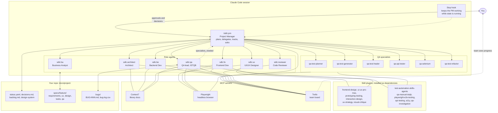

# ai-sdlc

GEM's Claude Code plugin marketplace for AI-assisted software delivery.

## sdlc plugin

`sdlc` turns Claude Code into a delivery team. A Project Manager agent takes a project from idea to pull request: it plans the work, hands each piece to a specialist agent, tracks progress in plain files inside your repo, and asks you whenever a decision is needed. You approve the backlog, every requirement set, every UX prototype, every technical design and every pull request; the agents do the rest.

## Architecture



How the pieces fit together:

- **The PM is the only orchestrator.** It runs in your main Claude Code session, so it can ask you questions directly. Every other agent is a subagent with a fresh context window that does one job and returns a short structured result.
- **Agents talk through files, never through chat.** `status.yaml` is the single source of truth. A dispatch tells each agent exactly which files to read and write, so the PM can stop at any time and resume later with `/sdlc:pm`.
- **Skills give each role its method.** The UX Designer and Frontend Developer use design skills; QA and its specialists use ISTQB and test automation skills. Required skills are enforced: agents report `skills_used` and the PM sends work back when one is missing.
- **MCP servers connect to the outside world.** Context7 for current library documentation, Playwright for a real headless browser, and Trello as an optional board the whole team can watch.
- **The Stop hook keeps the loop going.** While `state: running`, it stops the PM from ending its turn early, but only if `status.yaml` changed since the last push, so a stuck PM is allowed to stop.

## Workflow

```mermaid
flowchart LR
    idea(["Idea"]) --> disc["Discovery<br/>BA writes backlog"]
    disc --> g1{{"You approve<br/>backlog"}}
    g1 --> req["Requirements<br/>BA, EARS criteria"]
    req --> g2{{"You approve<br/>requirements"}}
    g2 -->|"has UI"| uxp["UX<br/>flows, design system,<br/>clickable prototype"]
    g2 -->|"no UI"| des
    uxp --> g3{{"You review<br/>prototype"}}
    g3 -->|"changes"| uxp
    g3 -->|"approved"| des["Design<br/>Architect: design.md,<br/>tasks.md"]
    des --> g4{{"You approve<br/>design"}}
    g4 --> td["Test design<br/>QA: plan, cases,<br/>traceability"]
    td --> build

    subgraph build["Build, per task in dependency order"]
        direction LR
        dev["BE or FE<br/>test first"] --> qx["QA execute<br/>evidence, bugs"]
        qx --> rv["Reviewer"]
        qx -->|"fail: bug reports"| dev
        rv -->|"fail: findings"| dev
    end

    build --> tr["Test report<br/>QA: exit criteria"]
    tr --> pr["Pull request<br/>with test report"]
    pr --> g5{{"You review<br/>and merge"}}
```



- A task that fails QA or review three times is marked `blocked` and the PM asks you how to proceed.
- If the test report shows open Critical or High bugs, the PM asks you whether to fix them first or release with the risk accepted, and logs your answer.
- Every question the PM asks comes with a recommended option, at most four per round, and is logged in `docs/project/decisions.md`.

## Components

| Component | Role |
|---|---|
| `/sdlc:pm` | Project Manager: plans, delegates, tracks status, asks you for decisions |
| `sdlc:ba` | Business Analyst: idea to backlog, feature to EARS requirements |
| `sdlc:ux` | UI/UX Designer: user flows, design system and a clickable HTML prototype you review before any code is written |
| `sdlc:architect` | Architect: requirements and approved UX to design and task list, each task owned by `be` or `fe` |
| `sdlc:be` | Backend Developer: APIs, logic and data, one task at a time, test first |
| `sdlc:fe` | Frontend Developer: builds the approved prototype on the shared design system, checked in a browser at desktop and mobile width |
| `sdlc:qa` | QA lead (ISTQB aligned): test plan, test cases and traceability per feature; executes each task with evidence; logs and retests bugs; writes the test summary report |
| `sdlc:qa-test-planner` | QA specialist: explores a running app and writes e2e scenarios |
| `sdlc:qa-test-generator` | QA specialist: turns scenarios into Playwright tests, performed live first |
| `sdlc:qa-test-healer` | QA specialist: root causes and fixes failing or flaky e2e tests |
| `sdlc:qa-api-tester` | QA specialist: API contract suites (Playwright request, Supertest, REST Assured) |
| `sdlc:qa-selenium` | QA specialist: Selenium 4, JUnit 5 and POM tests for Java projects |
| `sdlc:qa-test-refactor` | QA specialist: removes duplication and brittleness without changing coverage |
| `sdlc:reviewer` | Reviewer: correctness, security, scope and fit with the approved design |
| Stop hook | Keeps the PM working while `state: running` |
| Context7 MCP | Current library docs for Architect, BE, FE and QA |
| Playwright MCP | Headless browser for UX, FE, QA and the QA specialists |
| Trello MCP (official) | Optional live board: each role moves its own task cards |

## Install

```bash
claude plugin marketplace add pham-cao/ai-sdlc
claude plugin install sdlc@gem-ai-sdlc
npx playwright install chromium   # once, for the Playwright MCP
```

Requirements: Node.js 18 or later (the MCP servers run through `npx`) and Python 3 (used by the `ui-ux-pro-max` skill).

Installing `sdlc` also installs its skill dependencies, listed in this marketplace by reference to their upstream repos and pinned to a commit, so no code is copied:

| Plugin | Source | License | Used by |
|---|---|---|---|
| `frontend-design` | Anthropic | Apache 2.0 | UX, FE |
| `ui-ux-pro-max` | nextlevelbuilder | MIT | UX, FE |
| `prototyping-testing`, `interaction-design`, `ux-strategy`, `visual-critique` | Owl-Listener/designer-skills | MIT | UX |
| `test-automation-skills-agents` | fugazi | MIT | QA and QA specialists |

To move a dependency to a newer upstream version, update its `sha` in `.claude-plugin/marketplace.json`. If you had installed `frontend-design` or `ui-ux-pro-max` from their own marketplaces before, remove those copies to avoid duplicate skills, for example `claude plugin uninstall ui-ux-pro-max@ui-ux-pro-max-skill`.

**Optional setup**

- **Context7 key:** works without one at a lower rate limit. For higher limits, set `CONTEXT7_API_KEY` in your shell before starting Claude Code.
- **Trello:** run `/mcp`, pick `trello` and sign in with OAuth. The PM asks during discovery whether to use an existing board, create one, or skip Trello.
- **Companions:** `pr-review-toolkit` (the PM runs `/review-pr` before opening a PR when it is installed) and `superpowers`.

**Check the installation**

```bash
claude plugin list                       # sdlc and its 7 dependencies show "enabled"
claude plugin details sdlc@gem-ai-sdlc   # lists the 13 agents, the pm skill, the hook and 3 MCP servers
```

Inside Claude Code, open `/plugin` and check that the Errors tab is empty. The old `/agents` wizard has been removed from Claude Code; to see what an agent can do, ask Claude to describe it, for example "what tools does sdlc:qa have?".

## Update

```bash
claude plugin marketplace update gem-ai-sdlc
claude plugin update sdlc@gem-ai-sdlc
claude plugin install sdlc@gem-ai-sdlc   # installs any dependency added in the new release
```

`plugin update` does not install newly added dependencies; the extra `install` does, and is harmless when nothing is missing. Restart Claude Code afterwards.

## Use

In your project repo:

```
/sdlc:pm A web app for employees to book meeting rooms
```

Run `/sdlc:pm` with no arguments to resume, or ask "status?" for a summary of the current phase, tasks done, blocked items and what the PM needs from you.

To review a UX prototype, open `docs/project/specs/<feature>/ux/index.html` in a browser and click through it. Ask for changes as often as you like; backend and frontend work starts only after you approve it.

Tips:

- Start Claude Code with `claude --permission-mode acceptEdits` so the agents can edit files without asking each time.
- Put your project conventions (language, framework, naming) in the repo's `CLAUDE.md`; every agent reads it.
- Add `.claude/sdlc-stop.local` to your `.gitignore`.

## Files the PM creates in your repo

```
docs/project/
  status.yaml           single source of truth for progress
  decisions.md          append-only decision log
  backlog.md            features in priority order
  design-system.md      design system rules, created by the UX Designer
  design-system.css     the same tokens as CSS variables
  specs/<feature>/
    requirements.md     user stories and EARS acceptance criteria
    ux/                 flows.md, index.html, screens/, screenshots/, critique.md
    design.md           architecture, API contracts, data model
    tasks.md            tasks with owner, dependencies and done criteria
    qa/                 test-plan.md, test-cases.csv, traceability-matrix.csv,
                        test-execution-log.csv, evidence/, test-summary-report.md
  bugs/                 bug-log.csv and one BUG-NNN.md report per bug
```

## Trello board

When Trello is on, the board gets the lists `Backlog`, `To Do`, `Doing`, `QA`, `Review`, `Waiting for you`, `Blocked` and `Done`.

| Card | Created by | Moved by |
|---|---|---|
| One per feature | PM | PM, through Doing, Waiting for you and Done |
| One per task | Architect | BE or FE to Doing and QA; QA to Review or back; Reviewer to Done or back; PM to Blocked |
| One per bug (`BUG-NNN`, label `bug`) | QA | QA to Done when closed, back to To Do when reopened |

`status.yaml` stays the source of truth. If a Trello call fails, work continues and the failure is noted in the next status report.

## Repository layout

```
.claude-plugin/marketplace.json   the gem-ai-sdlc marketplace and pinned dependencies
plugins/sdlc/
  .claude-plugin/plugin.json      manifest, version and dependencies
  skills/pm/                      PM skill and status templates
  agents/                         the 13 agents
  hooks/                          Stop hook and its self test
  .mcp.json                       Context7, Playwright and Trello
  NOTICE.md                       third party licenses
docs/superpowers/specs/           design document for this plugin
```

## Develop and test

```bash
bash plugins/sdlc/hooks/test-stop-guard.sh
claude plugin validate .
claude plugin validate plugins/sdlc
claude --plugin-dir ./plugins/sdlc   # dependencies must already be installed from the marketplace
```

Bump `version` in `plugins/sdlc/.claude-plugin/plugin.json` for every release, or users will not receive it.

## Credits

Role prompts are written for GEM and draw on ideas from cc-sdd, GitHub Spec Kit, BMAD Method, Anthropic's feature-dev plugin and obra/superpowers. The six `qa-*` specialist agents are adapted from fugazi/test-automation-skills-agents under the MIT License; see `plugins/sdlc/NOTICE.md`.
